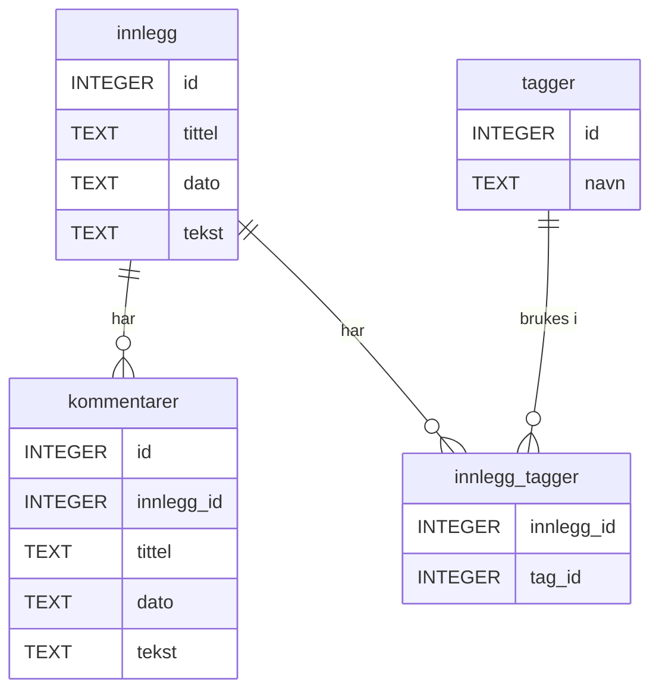

# Hundevennlig i Oslo: en bloggapp

En personlig blogg om hundevennlige kafeer og restauranter i Oslo, laget som prosjektoppgave i emnet PRO1002 Backend Essentials ved Oslo Nye Fagskole.

Appen er laget med Python, Flask, Jinja2 og SQLite. Stedene som omtales i eksempelinnleggene, er oppdiktet.

## Funksjoner

- Forside med alle innlegg, nyeste først, med dato, utdrag og tagger
- Egen side for hvert innlegg, med tagger og kommentarer
- Skjema for nye kommentarer, med validering
- Taggside som viser alle innlegg med en bestemt tag
- Lage og redigere innlegg, med tagger
- Slette innlegg, med en egen side for å bekrefte, og slette kommentarer
- Bekreftelsesmeldinger etter at noe er lagret, endret eller slettet
- Egen 404 side når en side eller et innlegg ikke finnes

## Installasjon

Du trenger Python 3.10 eller nyere og Git.

1. Klon repoet og gå inn i mappen:

   ```
   git clone https://github.com/Majagrorud/Pro1002-Blogg.git
   cd Pro1002-Blogg
   ```

2. Lag og aktiver et virtuelt miljø.

   Mac og Linux:
   ```
   python3 -m venv .venv
   source .venv/bin/activate
   ```

   Windows:
   ```
   python -m venv .venv
   .venv\Scripts\activate
   ```

3. Installer det appen trenger:

   ```
   pip install -r requirements.txt
   ```

4. Bygg databasen med eksempelinnhold:

   ```
   python init_db.py
   ```

   Kommandoen kan kjøres på nytt når som helst. Da settes databasen tilbake til de 10 opprinnelige innleggene.

## Kjøre appen

```
flask --app app run --debug
```

Åpne http://127.0.0.1:5000 i nettleseren.

På nyere Mac kan port 5000 være opptatt av AirPlay. Bruk da en annen port, og åpne http://127.0.0.1:5001:

```
flask --app app run --debug --port 5001
```

## Slik bruker du appen

- **Lese innlegg:** Klikk på en tittel på forsiden.
- **Se innlegg med samme tema:** Klikk på en tag, for eksempel «hund».
- **Kommentere:** Fyll ut skjemaet nederst på et innlegg og trykk «Send kommentar».
- **Skrive nytt innlegg:** Klikk på «+ Nytt innlegg» i menyen. Skriv taggene med komma mellom, for eksempel: hund, mat, oslo.
- **Redigere innlegg:** Klikk på «Rediger innlegg» under tittelen på et innlegg.
- **Slette innlegg:** Klikk på «Slett innlegg» under tittelen, og bekreft med «Ja, slett innlegget».
- **Slette kommentar:** Klikk på «Slett kommentar» under kommentaren.

## Kjøre testene

```
python -m unittest discover
```

Testene bruker en egen testdatabase (`test_blogg.db`), som lages før hver test og slettes etterpå. Den ekte databasen blir ikke påvirket.

| Fil | Hva den tester |
| --- | --- |
| `tests/test_db.py` | Integrasjonstester: at funksjonene i `db.py` leser og skriver riktig i databasen |
| `tests/test_app.py` | Ende til ende tester med Flask sin testklient: sidene, skjemaene, validering, sletting, bekreftelsesmeldinger, 404 og beskyttelse mot script injection |

## Sider og HTTP metoder

| Adresse | Metode | Hva den gjør |
| --- | --- | --- |
| `/` | GET | Forsiden med alle innlegg |
| `/innlegg/<id>` | GET | Viser ett innlegg med tagger og kommentarer |
| `/innlegg/<id>/kommentar` | POST | Lagrer en ny kommentar |
| `/innlegg/ny` | GET | Viser skjema for nytt innlegg |
| `/innlegg/ny` | POST | Lagrer det nye innlegget |
| `/innlegg/<id>/rediger` | GET | Viser skjemaet, ferdig utfylt |
| `/innlegg/<id>/rediger` | POST | Lagrer endringene |
| `/innlegg/<id>/slett` | GET | Viser siden der man bekrefter sletting |
| `/innlegg/<id>/slett` | POST | Sletter innlegget og kommentarene til det |
| `/kommentar/<id>/slett` | POST | Sletter en kommentar |
| `/tag/<navn>` | GET | Viser alle innlegg med en bestemt tag |

GET brukes bare til å vise sider. POST brukes til alt som endrer databasen, også sletting, og etter en vellykket POST sendes brukeren videre med redirect (Post/Redirect/Get).

## Databasen



Tabellen `innlegg_tagger` kobler innlegg og tagger, fordi ett innlegg kan ha mange tagger, og én tag kan høre til mange innlegg. Når et innlegg slettes, slettes også kommentarene og taggkoblingene, slik at fremmednøklene aldri peker på noe som ikke finnes.

## Prosjektstruktur

```
app.py            Flask appen med alle rutene
db.py             Alle funksjoner som snakker med databasen
init_db.py        Bygger databasen fra schema.sql og data.sql
schema.sql        Tabellene i databasen
data.sql          Eksempelinnhold: 10 innlegg, tagger og kommentarer
templates/        Jinja2 maler, der alle arver fra base.html
static/style.css  Stilark
tests/            Automatiske tester
```

## Validering og sikkerhet

- **Kommentarer:** Tittel og tekst må fylles ut. Tittelen kan ha maks 100 tegn, og teksten maks 1000 tegn.
- **Innlegg:** Tittel og tekst må fylles ut. Tittelen kan ha maks 150 tegn.
- Ved feil vises en feilmelding, det brukeren skrev, blir stående, og serveren svarer med statuskode 400.
- Alle SQL spørringer bruker parametere (`?`), som beskytter mot SQL injection.
- Jinja2 escaper alt innhold automatisk, som beskytter mot script injection. Dette er testet i `test_script_i_kommentar_blir_escapet`.
- Sletting skjer bare med POST, aldri med en vanlig lenke.
- Den hemmelige nøkkelen som bekreftelsesmeldingene trenger, hentes fra miljøvariabelen `SECRET_KEY`.

## Kjente begrensninger

- Ingen innlogging, så alle kan lage, redigere og slette innlegg.
- Ingen beskyttelse mot CSRF.
- Kommentarer slettes uten en egen side for å bekrefte.
- Er `SECRET_KEY` ikke satt, brukes en nøkkel som bare er ment for utvikling.
- Tagger som ikke lenger brukes av noe innlegg, blir liggende i databasen.

## Mulige forbedringer

- Innlogging, slik at bare eieren av bloggen kan skrive, redigere og slette
- Bilder i innlegg
- Søk og en liste over mest leste innlegg
- Design tilpasset mobil

## Bruk av KI

KI er brukt som hjelpemiddel i utviklingen og til å lage eksempelinnholdet i `data.sql`. Se refleksjonsloggen for mer om dette.

## Lisens

MIT, se `LICENSE`.